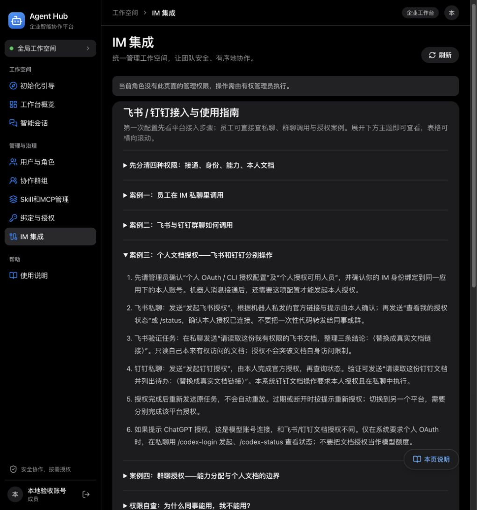

# IM 说明书扩展验收（2026-11-07）

本轮只修改本地前端文档与展示，不部署、不提交 Git、不修改真实平台配置或数据库。

| 内容 | 结果 |
|---|---|
| 主题 | 13 个：四层权限、飞书接入、钉钉接入、模式比较、私聊调用、群聊调用、个人文档授权、群聊授权边界、OAuth 应用配置、Skill/MCP 分配、自查、指令、故障排查 |
| 展示入口 | IM 集成页直接展开；独立说明书与本页说明共用内容 |
| 角色过滤 | 成员可读使用案例；平台配置仅超管、能力分配操作仅资源管理员可见 |
| 搜索 | 支持正文、表格、指令及错误码，自动展开命中主题 |
| 自动验证 | 全套 267 项通过；搜索展开优化后相关 30 项通过；TypeScript/Vite 构建通过 |
| 浏览器 | 模拟 API 下验证 IM 页成员指南、展开操作、管理员搜索；390px 视口页面无横向溢出，表格可独立滚动 |

主要文件：frontend/src/imHelpContent.ts、HelpSections.tsx、HelpSections.css、pageHelpContent.ts、Manual.tsx、PageHelp.tsx、Management.tsx、Manual.test.tsx。

业务语义对照 backend/app/im_commands.py、platform_workspace.py、platform_broker.py、platform_access.py、policy.py，以及 frontend/src/OAuthConfig.tsx 和项目 docs/IM_SETUP.md。

平台文档参考已内置到对应主题：
- [飞书长连接](https://open.feishu.cn/document/ukTMukTMukTM/uYDNxYjL2QTM24iN0EjN/event-subscription-configure-)
- [飞书消息与事件权限](https://open.feishu.cn/document/uAjLw4CM/ukTMukTMukTM/reference/im-v1)
- [钉钉官方 Stream 机器人教程](https://open-dingtalk.github.io/developerpedia/docs/explore/tutorials/stream/bot/python/create-bot/)
- [钉钉官方 Stream 概述](https://opensource.dingtalk.com/developerpedia/docs/learn/stream/overview/)

未进行真实飞书/钉钉消息发送、授权或第三方 MCP 调用；文档案例不是业务任务成功记录。既有 bundle 大小提示仍存在。

