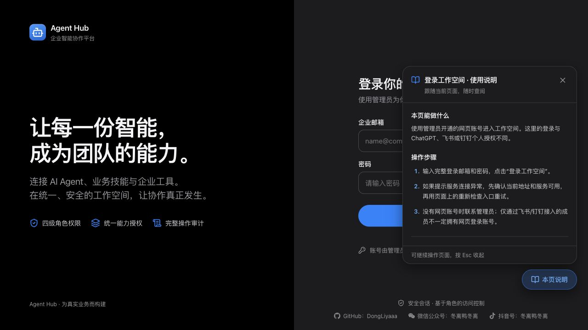

# 初始化引导与独立说明书：上线记录

上线结果：成功。目标为本机 Docker codex-hub-v1，入口 http://127.0.0.1:18210；不涉及远端服务器发布。

用户已明确批准隔离 PostgreSQL 测试及测试通过后仅替换 API。

| 项目 | 结果 |
|---|---|
| 发布镜像 | codex-hub-v1-api:onboarding-20261107（amd64） |
| 镜像 ID | sha256:2a93d959b302120fb49c2cff4a75b326f5ac9822bb80516abe8de693d9a99a41 |
| API 容器 | 4513206f42c275b438d30baea9967075c717240acea9d76effcf815505fb6c37 |
| API 健康 / 重启次数 | healthy / 0 |
| 前端包 | index-DrwfdLSo.js；与本地验收构建逐字节一致 |
| 后端源码 | 容器内全部 Python 文件哈希与本地一致 |
| 数据库迁移 | users.onboarding JSON 可空、无默认值；5 个旧用户均保持 NULL |
| 隔离数据库验证 | 23 项通过，覆盖重复迁移、跨登录持久化、旧数据保留与越权拒绝 |
| 前端验证（前一验收阶段） | 266 项通过，构建通过 |
| 其他容器 | 14 个运行容器的 ID、镜像、启动时间、重启次数保持不变 |
| 临时测试容器 | 已清理；不复用现有数据卷或网络 |
| 线上检查 | health 200、setup/status 为 true、未登录写引导接口返回 401；登录页和帮助浮窗交互正常 |
| 启动日志 | 未发现 traceback、fatal、exception 标记 |

## 范围与限制

相对上线前运行 API，后端只有 main.py、models.py、schemas.py、setup.py、im_migrations.py 的引导相关变更。runner、IM 和附件容器均未替换。没有提交或推送 Git。

现有账号请从导航第一项“初始化引导”手动进入；不会因升级而触发首个管理员引导。真实账号登录后的新页面本轮未实测，浏览器完整流程已在模拟 API 下验收；真实 PostgreSQL 存储行为由隔离数据库集成测试验证。未调用付费模型或发送 IM 消息。

## 回滚准备

旧镜像：`codex-hub-v1-api:pre-onboarding-20261107`。

数据库备份：`/Users/dongli/Projects/codex-im/.runtime/releases/20261107-onboarding/database-before.dump`（权限 0600，不放入 Git 或镜像）。容器部署前后快照保存在同目录 before.json / after.json。

回滚 API 可将旧镜像重新标记为 `codex-hub-v1-api:amd64-local`，再用现有两个 compose 文件运行 `up -d --no-deps --no-build --wait api`。新增可空列兼容旧代码，常规应用回滚无需删除列或恢复整个数据库；备份恢复属于单独的数据恢复操作。

