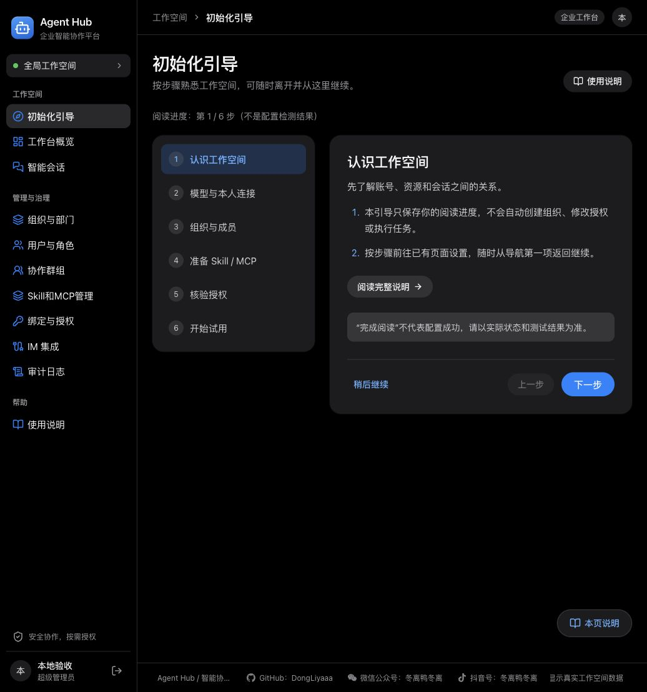
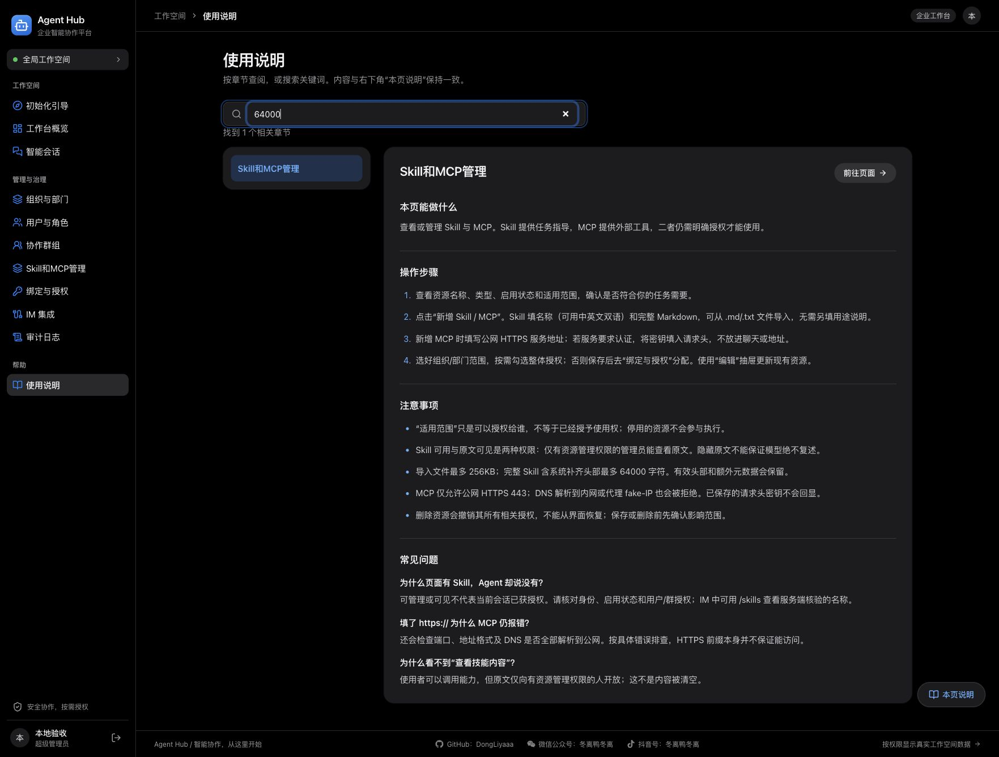
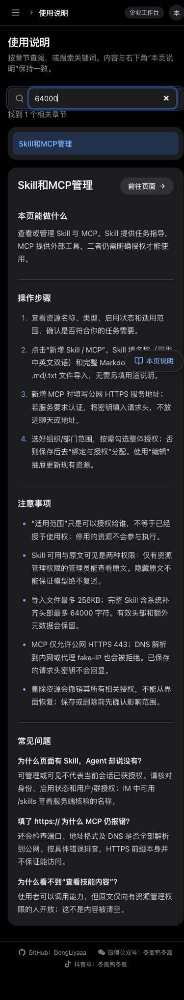
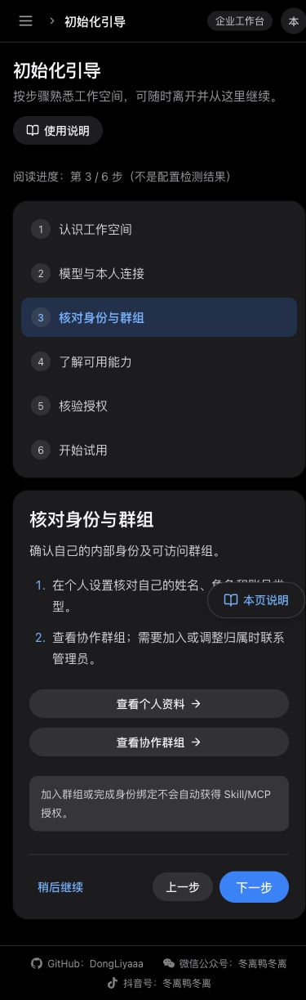
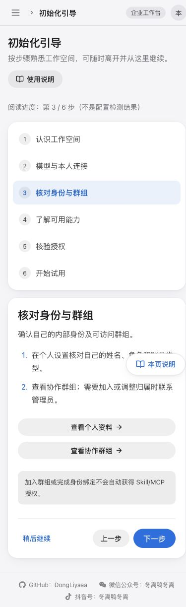

# 初始化引导与独立说明书：本地验收

日期：2026-11-07（Asia/Shanghai）

## 接续来源与范围

接续 Claude Code「codex-im」对话（会话 63858ac7-f4d0-4e87-851e-ae01a2c8be72）。最后业务需求：首次注册管理员登录后初始化引导、导航第一项、独立说明书。原会话在浏览器验收前因上下文超限中断。

本轮保留已有全部未提交业务代码，重新执行测试与构建，并完成模拟接口下的浏览器验收；没有为通过验收而修改业务实现。新增本报告与截图。

## 验收结果

| 步骤 | 检查 | 结果 |
|---|---|---|
| 1 | 模拟首次注册 → 登录 | 注册后返回登录页，正常 |
| 2 | 首个管理员登录 | 自动进入初始化引导；导航排第一，正常 |
| 3 | 下一步 → 刷新 | 恢复第二步，正常 |
| 4 | 稍后继续 → 刷新 → 手动返回 | 留在概览，手动返回恢复阅读位置，正常 |
| 5 | 最后一步完成阅读 | 显示已完成阅读，正常 |
| 6 | 独立说明书全文搜索 | 64000 命中资源章节；无结果提示与清空恢复正常 |
| 7 | 手机目录跳转 | 聚焦正文；注册说明没有重新注册按钮，正常 |
| 8 | 旧管理员与普通成员 | 旧账号保持概览；成员不显示组织目录与审计章节，正常 |
| 9 | 手机引导与说明书 | 390px 视口无横向溢出；引导浅色、深色均可阅读 |

| 自动检查 | 结果 |
|---|---|
| npm test -- --run | 24 个测试文件，266 项通过 |
| npm run build | TypeScript 与 Vite 构建通过 |
| PYTHONPATH=backend .venv/bin/pytest tests/test_onboarding.py -q | 16 项通过 |
| git diff --check | 通过 |
| 浏览器错误日志 | 本次检查未捕获 error 日志 |

## 边界与后续真实环境验证

- 浏览器使用实际构建前端与仅内存模拟 API；模拟账号与密码不属于真实账号。刷新续读验证的是前端与模拟状态协作，不能证明真实 PostgreSQL 持久化。
- 真实 PostgreSQL 迁移、跨登录持久化回归未运行。对应测试已存在于 tests/test_setup.py；上线前仍需在获准的隔离 PostgreSQL 环境执行。
- 没有创建容器、写入真实数据库、发送 IM 消息、调用模型、部署、提交或推送 Git。
- 构建有主 bundle 超过 500 kB 的提示；测试有既有 Starlette/httpx 弃用提示，均未阻止通过。
- 手机上的既有“本页说明”浮钮仍在底部上方 88px，可能覆盖当前滚动位置的少量文字；可滚动阅读，本轮保留原对话明确指定的位置。
- 本次不是完整无障碍审计或生产环境验收。

## 主要实现文件（原会话已有）

- frontend/src/Onboarding.tsx、Manual.tsx、Guides.css
- frontend/src/main.tsx、route.ts、api.ts、pageHelpContent.ts
- backend/app/main.py、setup.py、models.py、schemas.py、im_migrations.py
- frontend/src/Onboarding.test.tsx、Manual.test.tsx、navigation.test.tsx
- tests/test_onboarding.py、test_setup.py

## 截图

